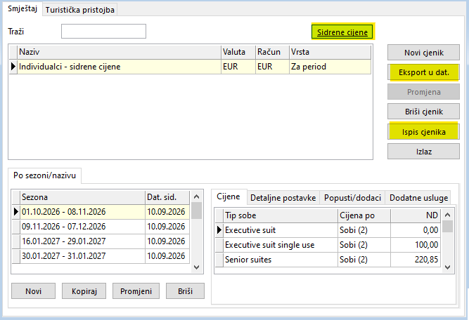
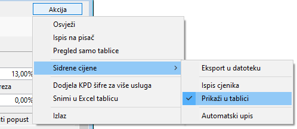
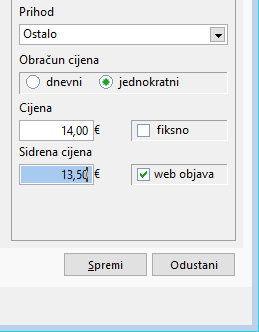
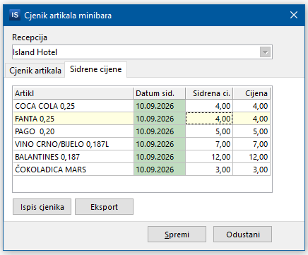

# Sidrene cijene – hotelijerstvo

Upute su namijenjene voditeljima hotela i administratorima sustava radi usklađivanja sa zakonskim propisima o transparentnosti cijena i zaštiti potrošača.

!!! info "Sidrene ili bazne cijene?"
    Koristit ćemo naziv **Sidrene cijene** iako bi ispravan naziv bio *Bazne cijene*. Razlog tome je što se naziv *Sidrene cijene* koristi već duže vrijeme za istu materiju kojoj je novim zakonskim izmjenama dodijeljen naziv *Bazna cijena*.

## Uvod

S obzirom na specifičnost djelatnosti smještaja, razjasnimo obveze koje hotel ima u vezi cjenika neovisno o Zakonu o baznim cijenama.

Hotel je zakonski dužan imati službeni, važeći cjenik za sve usluge koje pruža, što u hotelskoj praksi odgovara pojmu osnovnog (rack) cjenika.

Prema hrvatskim propisima (prvenstveno **Zakonu o ugostiteljskoj djelatnosti** i **Zakonu o zaštiti potrošača**), obveze hotela u vezi s osnovnim cjenikom su sljedeće:

* **Vidljivost i dostupnost:** Cjenik mora biti jasno istaknut na vidljivom mjestu na recepciji te dostupan gostima u svakoj smještajnoj jedinici (ili putem jasno istaknutog digitalnog pristupa, npr. QR koda, ovisno o standardu objekta).
* **Sadržaj cjenika:** Mora obuhvaćati sve vrste smještaja i dodatnih usluga koje hotel nudi, s jasno istaknutim cijenama u eurima i uključenim PDV-om (te napomenom o turističkoj pristojbi).
* **Pridržavanje istaknutih cijena:** Osnovni (rack) cjenik predstavlja maksimalnu redovnu cijenu usluge. Hotel smije prodavati sobe po nižim cijenama (kroz dinamičko određivanje cijena, early booking, last minute akcije ili ugovore s agencijama), ali gostu na recepciji ne smije naplatiti više od iznosa navedenog u važećem cjeniku.

## Zakonski i fiskalni okvir

* **Definicija:** Sidrena cijena označava cijenu po kojoj se određeni artikl/usluga nudila na **10.9.2026.** ili na datum kad je prvi put stavljen/a na prodaju, ako je taj dan kasniji od 10.9.2026. (tj. ako na 10.9.2026. tog artikla/usluge nije bilo u ponudi).
* **Fiskalizacija i izdavanje računa:**
    * Na fiskalnom računu koji se uručuje gostu iskazuje se i naplaćuje **isključivo trenutna važeća cijena**.
    * Sidrena cijena je evidencijski i informativni podatak koji se prikazuje u cjeniku i promidžbenim materijalima, ali ne utječe na fiskalnu osnovicu računa.
* **Objava podataka:** Na web stranicama hotela obavezno je osigurati uvid u datoteku s cijenama, bez obzira na to imate li cjenik na webu ili samo informacije o hotelu.

## Lokacija postavki u programu

U programu postoje tri vrste cjenika za koje je potrebno definirati sidrene cijene i iste objavljivati na web stranicama hotela:

* [Cjenik smještaja](#cjenik-smjestaja)
* [Cjenik dodatnih usluga](#cjenik-dodatnih-usluga)
* [Cjenik minibara](#cjenik-minibara)

## Cjenik smještaja

Sve radnje definiraju se unutar prozora **Administracija -> Cjenici -> Izrada i promjena cjenika**. Sustav sidrenih cijena za cjenik smještaja napravljen je tako da imate dva cjenika: **OSNOVNI** i **SIDRENI**. Osnovni cjenik je gore spomenuti cjenik kojeg morate imati i po kojem radite prijavu i naplatu gostima. SIDRENI cjenik je povezan s OSNOVNIM.

!!! warning "Ažurirajte oba cjenika"
    Kad ažurirate osnovni cjenik, obavezno morate ažurirati i sidreni.

### Postupak postavljanja

Prvo što trebate napraviti je odabrati vaš OSNOVNI (RACK) cjenik. Nakon toga kliknete na gumb **Sidrene cijene**. Kad to radite prvi put, odabrani cjenik će se automatski kopirati u vaš cjenik sidrenih cijena. Za sve postojeće cijene osnovnog cjenika će se u sidreni cjenik upisati sidreni datum 10.9.2026. Kad budete dodavali nove periode, za sidreni datum će se upisati datum kad ažurirate sidreni cjenik.

{: width="667" }

### Generiranje datoteke za web objavu

1. Ako je potrebno, prije eksporta u datoteku možete na desni klik miša na gumb **Eksport** odabrati opciju za postavljanje prefiksa datoteke.
2. Za generiranje datoteke kliknite **Eksport**.
3. Odaberite mapu na računalu za spremanje datoteke.
4. Dobivenu datoteku postavite na poslužitelj ili proslijedite administratoru vaše web stranice.

!!! tip "Napomena"
    Cjenik nije potrebno svakodnevno snimati i objavljivati na web stranicama, već samo kada dođe do promjene cijena.

## Cjenik dodatnih usluga

Sve radnje definiraju se unutar prozora **Matični -> Vrste usluge za goste**.

* **Skupne radnje i eksport:** gumb **Akcija** (gore desno) -> **Sidrene cijene**

    {: width="498" }

* **Pojedinačne postavke:** na desnoj strani prozora, u donjem dijelu ispod polja **Cijena**, nalazi se polje **Sidrena cijena** i opcija **web objava**.

    {: width="259" }

    !!! warning "Usluge s dinamičkim cijenama"
        Za usluge koje imaju dinamičko određivanje cijena nije potrebno isticati na webu, pa obavezno maknite kvačicu s **web objave**.

* **Prikaz u tablici:** stupac **Sidrena ci.** u glavnoj tablici (uključuje se putem *Akcija -> Sidrene cijene -> Prikaži u tablici*).

### Postupak postavljanja

Preporuka je da najprije napravite automatsko postavljanje za sve usluge, a onda napravite ručnu korekciju pojedinačnih usluga.

#### Automatsko postavljanje za cijeli cjenik

1. U gornjem lijevom dijelu odaberite prikaz **dodatnih usluga**.
2. U gornjem desnom kutu kliknite na **Akcija -> Sidrene cijene -> Automatski upis**.
3. Program će upisati trenutne cijene prikazanim uslugama. Ako ponavljate postupak, samo nove usluge će dobiti sidrenu cijenu.
4. Sustav automatski popunjava stupac **Sidrena ci.** u tablici.

#### Pojedinačna ručna izmjena

1. Odaberite željenu uslugu na popisu u tablici.
2. Na desnoj strani ekrana, u polje **Sidrena cijena**, upišite željenu cijenu.
3. Po potrebi označite ili odznačite kvačicu **web objava**.
4. Spremite promjene.

### Generiranje datoteke za web objavu

1. Kliknite **Akcija -> Sidrene cijene -> Eksport u datoteku**.
2. Odaberite mapu na računalu za spremanje datoteke.
3. Dobivenu datoteku postavite na poslužitelj ili proslijedite administratoru vaše web stranice.

!!! tip "Napomena"
    Cjenik nije potrebno svakodnevno snimati i objavljivati na web stranicama, već samo kada dođe do promjene cijena.

## Cjenik minibara

Sve radnje definiraju se u prozoru **Administracija -> Minibar -> Cjenik artikala minibara**.

Otvorite karticu **Sidrene cijene**.

{: width="436" }

Datum sidrenih cijena kao i sidrenu cijenu upisujete ručno za svaki artikl direktno u tablicu. Nakon što ispravno upišete datum i cijenu, cjenik možete ispisati i možete napraviti eksport datoteke za objavu na web stranicama hotela.

!!! warning "Spremite promjene"
    Obavezno na kraju kliknite na gumb **Spremi** jer ćete u protivnom ostati bez upisanih podataka.
