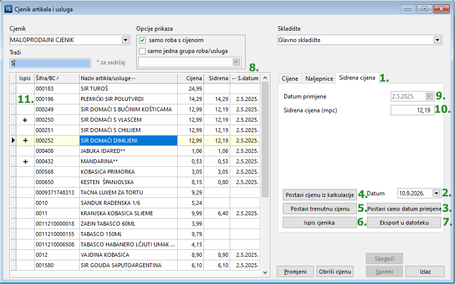
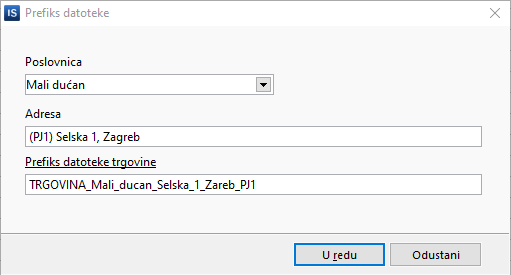

# Sidrene cijene – maloprodaja

Sidrene cijene se postavljaju u cjeniku **Maloprodaja -> Cjenik artikala i usluga**.

{: width="656" }

## Opis numeriranih akcija

1. **Sidrena cijena** – kartica sa sidrenim cijenama.
2. **Datum** – datum na koji se postavljaju sidrene cijene.
3. **Postavi samo datum primjene** – zapisuje datum sidrenih cijena po artiklima.
    - Postavlja datum sidrene cijene **SVIM** artiklima koji **NEMAJU** postavljen datum.
    - Postavlja **NOVI** datum sidrene cijene **SAMO ODABRANIM** artiklima.
4. **Postavi cijenu iz kalkulacije** – postavlja sidrenu cijenu po artiklima prema datumu sidrene cijene za svaki artikl, na način da pronađe cijenu na sidreni datum (traži cijene iz kalkulacija, početnog stanja i nivelacija). Ako neki artikl nema upisan datum, upisat će se datum sidrene cijene (2.).
    - Postavlja sidrenu cijenu **SVIM** artiklima koji još **NEMAJU** postavljenu sidrenu cijenu.
    - Postavlja sidrenu cijenu **SAMO ODABRANIM** artiklima.
5. **Postavi trenutnu cijenu** – postavlja **TRENUTNU** cijenu kao sidrenu.
    - Postavlja sidrenu cijenu **SVIM** artiklima koji još **NEMAJU** postavljenu sidrenu cijenu.
    - Postavlja sidrenu cijenu **SAMO ODABRANIM** artiklima.
6. **Ispis cjenika** – ispis cjenika sa sidrenim cijenama.
7. **Eksport u datoteku** – snimanje datoteke sa sidrenim cijenama za postavljanje na internet stranice.
8. **Sidrena** i **S.datum** – kolone sa sidrenim cijenama i datumom sidrene cijene.
9. **Datum primjene** – datum sidrene cijene za trenutni artikl.
10. **Sidrena cijena** – sidrena cijena za trenutni artikl.
11. **Ispis** – stupac u kojem se vidi koji su artikli označeni.

!!! info "Odabrani artikli"
    Prilikom postavljanja, cijene će se postaviti samo odabranim artiklima. U slučaju da nije odabran niti jedan artikl, cijene će se postaviti svim artiklima.

## Postupak postavljanja

### Ručno postavljanje za pojedini artikl

Sidrene cijene je moguće postaviti ručno za svaki artikl. Klikom na **Promjeni** omogućuje se upis datuma (9.) i sidrene cijene (10.). Nakon toga je potrebno kliknuti **Spremi**.

### Postavljanje svim artiklima

Najbolje je slijediti sve korake od 1. do 7.

1. Otvorite karticu **Sidrena cijena**.
2. Provjerite da je za datum sidrenih cijena upisan **10.09.2026.**
3. Postavite datum za sidrene cijene (**Postavi samo datum primjene**) – ovaj korak se može i preskočiti jer će sljedeći korak postaviti i datum.
4. Postavite sidrenu cijenu i datum (**Postavi cijenu iz kalkulacije**) – program će potražiti po ulaznim dokumentima i upisati ispravnu sidrenu cijenu (i datum, ako još nije bio upisan). Ponavljanjem ove radnje program traži i postavlja ispravnu sidrenu cijenu na datum sidrene cijene koji je upisan uz svaki artikl.
5. **Postavi trenutnu cijenu** možete koristiti ako ne koristite kalkulacije.
6. **Ispis cjenika** sa sidrenim cijenama.
7. Snimanje datoteke za internet (**Eksport u datoteku**).

    Prije snimanja potrebno je na desni klik upisati podatke o poslovnici, tj. nazivu datoteke.

    !!! warning "Naziv datoteke"
        Naziv datoteke je zakonski definiran, pa je najbolje samo kliknuti na **Prefiks datoteke trgovine**.

    {: width="389" }
