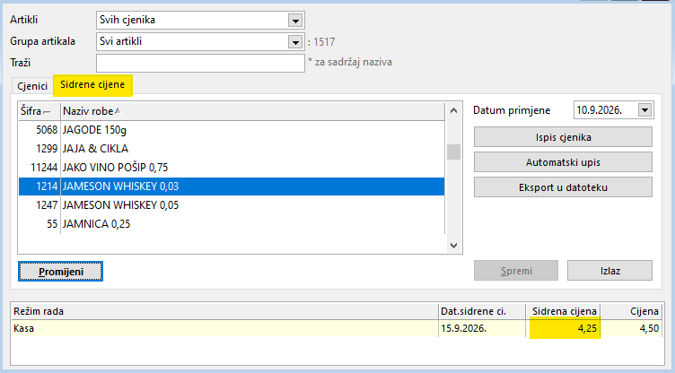
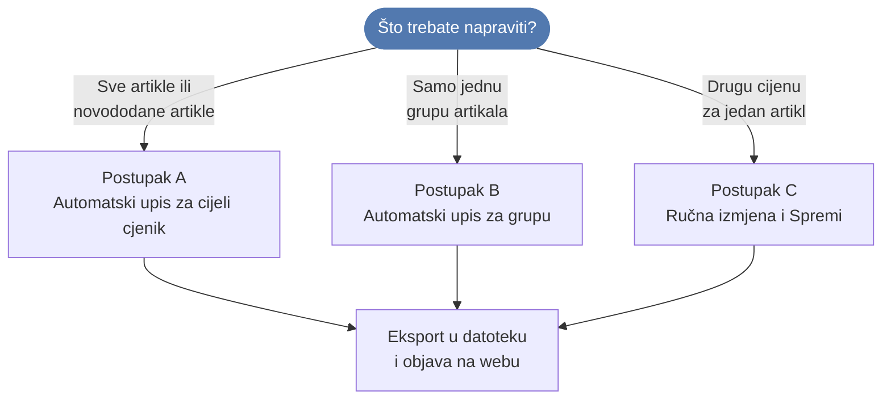
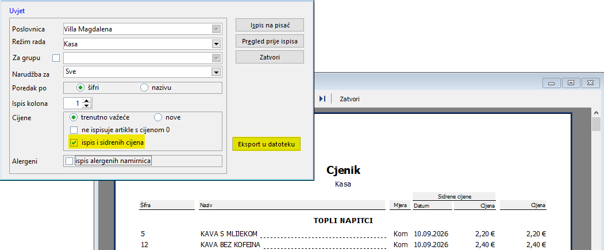

# Sidrene cijene – ugostiteljstvo

Upute su namijenjene voditeljima ugostiteljskih objekata i administratorima sustava radi usklađivanja sa zakonskim propisima o transparentnosti cijena i zaštiti potrošača.

!!! info "Sidrene ili bazne cijene?"
    Koristit ćemo naziv **Sidrene cijene** iako bi ispravan naziv bio **Bazne cijene**. Razlog tome je što se naziv *Sidrene cijene* koristi već duže vrijeme za istu materiju kojoj je novim zakonskim izmjenama dodijeljen naziv *Bazna cijena*.

## Zakonski i fiskalni okvir

* **Definicija:** Sidrena cijena označava cijenu po kojoj se određeni artikl/usluga nudila na **10.9.2026.** ili na datum kad je prvi put stavljen/a na prodaju, ako je taj dan kasniji od 10.9.2026. (tj. ako na 10.9.2026. tog artikla/usluge nije bilo u ponudi).
* **Fiskalizacija i izdavanje računa:**
    * Na fiskalnom računu koji se uručuje gostu iskazuje se i naplaćuje **isključivo trenutna važeća cijena**.
    * Sidrena cijena je evidencijski i informativni podatak koji se prikazuje u cjeniku i promidžbenim materijalima, ali ne utječe na fiskalnu osnovicu računa.
* **Objava podataka:** Ugostiteljski objekti koji posjeduju web stranicu firme/obrta dužni su na istoj osigurati uvid u datoteku sa sidrenim cijenama – bez obzira na to imate li cjenik na webu ili samo informacije o ugostiteljskom objektu.

## Lokacija postavki u programu

Sve radnje definiraju se unutar modula cjenika po režimima:

* **Navigacija:** **Ugostiteljstvo -> Cjenik -> Po režimima**
* **Odabir:** Na vrhu tablice artikala odaberite karticu **Sidrene cijene**.

## Pregled radnih gumba i polja

| Funkcija / element | Opis i svrha radnje |
| :----------------- | :------------------ |
| **Datum primjene** | Definira datum na koji želite postaviti sidrenu cijenu. |
| **Ispis cjenika** | Generira službeni cjenik s prikazom stupaca za sidrenu cijenu i datum (prije ispisa obavezno uključite opciju *ispis i sidrenih cijena*). |
| **Automatski upis** | Upisuje odabrani datum artiklima koji ga nemaju. |
| **Eksport u datoteku** | Generira standardiziranu datoteku za objavu na internetskoj stranici. |
| **Promijeni** | Omogućuje da ručno promijenite sidrenu cijenu. |
| **Spremi** | Sprema novu upisanu cijenu na postavljeni datum primjene. |

{: width="596" }

## Postupak postavljanja

Koji postupak trebate? Kliknite na korak u dijagramu za upute.

### Postupak A: Automatsko postavljanje za cijeli cjenik

1. Otvorite karticu **Sidrene cijene** u cjeniku artikala po režimima.
2. U polju za datum provjerite ili unesite referentni datum (**10.9.2026.**).
3. Kliknite na **Automatski upis**. Program će upisati trenutne cijene prikazanim artiklima. Ako ponavljate postupak, samo novi artikli će dobiti sidrenu cijenu.
4. Sustav automatski popunjava stupce **Sidrena cijena** i **Dat.sidrene ci.**

### Postupak B: Postavljanje za odabrane grupe ili artikle

1. U padajućem polju odaberite grupu artikala koje želite dohvatiti.
2. Pokrenite funkciju **Automatski upis**.
3. Promjene će se primijeniti isključivo na označene artikle.

### Postupak C: Pojedinačna ručna izmjena

1. Odaberite željeni artikl na popisu.
2. U gornjem desnom dijelu ekrana unesite točan **Datum primjene**.
3. Kliknite gumb **Promijeni** na dnu prozora.
4. U tablicu cjenika, u kolonu **Sidrena cijena**, upišite cijenu.
5. Kliknite **Spremi**.

## Generiranje datoteke za web objavu

1. Na kartici sidrenih cijena kliknite gumb **Eksport u datoteku**.
2. U dijaloškom okviru provjerite odabir poslovne jedinice.
3. Desnom tipkom miša kliknite na gumb **Eksport u datoteku** i na opciju **Prefiks datoteke** kako bi sustav automatski formirao propisani tehnički naziv (npr. `UGOSTITELJSTVO_NazivObjekta_Adresa_PJ`) ili ga ručno ispravite.
4. Potvrdite unos klikom na **U redu** i odaberite mapu za spremanje na računalu.
5. Dobivenu datoteku postavite na poslužitelj ili je proslijedite administratoru vaše web stranice.

!!! tip "Napomena"
    U ugostiteljstvu niste obvezni svaki dan snimati cjenik na vaše web stranice, nego samo kad dođe do promjene cijena.

{: width="591" }
