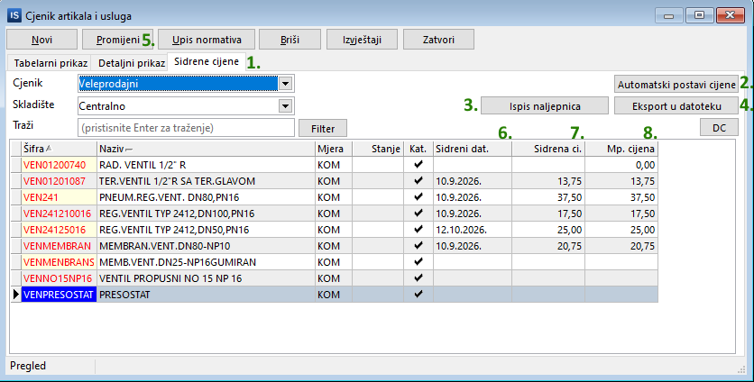
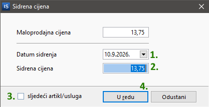
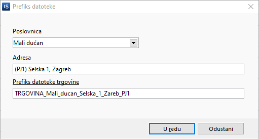

# Sidrene cijene – veleprodaja

!!! info "Sidrene ili bazne cijene?"
    Koristit ćemo naziv **Sidrene cijene** iako bi ispravan naziv bio *Bazne cijene*. Razlog tome je što se naziv *Sidrene cijene* koristi već duže vrijeme za istu materiju kojoj je novim zakonskim izmjenama dodijeljen naziv *Bazna cijena*.

## Zakonski i fiskalni okvir

* **Definicija:** Sidrena cijena označava cijenu po kojoj se određeni artikl ili usluga nudila na **10.9.2026.** ili na datum kad je prvi put stavljen/a na prodaju, ako je taj dan kasniji od 10.9.2026. (tj. ako na 10.9.2026. tog artikla/usluge nije bilo u ponudi).
* **Fiskalizacija i izdavanje računa:**
    * Na fiskalnom računu koji se uručuje gostu iskazuje se i naplaćuje **isključivo trenutna važeća cijena**.
    * Sidrena cijena je evidencijski i informativni podatak koji se prikazuje u cjeniku i promidžbenim materijalima, ali ne utječe na fiskalnu osnovicu računa.
* **Objava podataka:** Trgovine koje posjeduju web stranicu dužne su na istoj osigurati uvid u datoteku sa sidrenim cijenama, bez obzira na to imaju li cjenik na webu ili samo informacije o firmi.
* **Obveza:** U samoj veleprodaji nije potrebno imati upisane sidrene cijene. Sidrene cijene su obavezne samo u poslovanju s građanstvom (B2C). Ali, ako imate **maloprodaju iz veleprodaje**, obveznici ste istaknuti i sidrene cijene za svu robu i usluge koje nudite.

## Postupak postavljanja

Sidrene cijene se postavljaju u cjeniku **Fakturiranje -> Cjenik -> Artikala i usluga**.

### Postupak A: Automatsko postavljanje za cijeli cjenik

{: width="836" }

Opis numeriranih akcija:

1. Kartica sa sidrenim cijenama.
2. **Automatski upis sidrenih cijena** – postavlja sidrenu cijenu i datum svim artiklima na način da pronađe cijenu na sidreni datum (traži cijene iz kalkulacija, početnog stanja i nivelacija). Ako neki artikl nema upisan datum, upisat će se zakonski definirani datum sidrene cijene (10.09.2026.), ili datum prve kalkulacije ako je artikl uveden u prodaju nakon tog datuma.
3. Otvara prozor za ispis naljepnica.
4. Snimanje datoteke sa sidrenim cijenama za postavljanje na internet stranice.
5. Otvara prozor za ručnu promjenu cijene i datuma za pojedini artikl.
6. Datum sidrene cijene.
7. Sidrena cijena artikla.
8. Maloprodajna cijena artikla.

### Postupak B: Pojedinačna ručna izmjena

Osim automatskog postavljanja cijena za sve artikle, sidrenu cijenu i datum je moguće posebno postaviti ručno za svaki artikl. Klikom na **Promijeni** (5) otvara se prozor za upis sidrene cijene. Tu je moguće upisati/promijeniti datum sidrenja (1) i sidrenu cijenu (2). Za spremanje je potrebno kliknuti **U redu** (4). Opcija **Sljedeći artikl/usluga** (3) automatski prelazi na sljedeći artikl za upis cijene.

{: width="417" }

## Generiranje datoteke za web objavu

Datoteku za postavljanje na web možete snimiti klikom na **Eksport u datoteku**. Prije snimanja potrebno je na desni klik upisati podatke o poslovnici, tj. nazivu datoteke.

!!! warning "Naziv datoteke"
    Naziv datoteke je zakonski definiran, pa je najbolje samo kliknuti na **Prefiks datoteke trgovine**.

{: width="511" }
