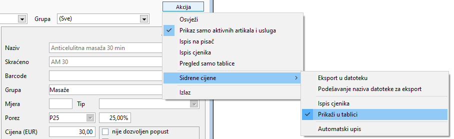
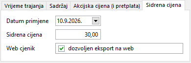
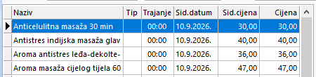

# Sidrene cijene – wellness

Upute su namijenjene voditeljima wellness centara i administratorima sustava radi usklađivanja sa zakonskim propisima o transparentnosti cijena i zaštiti potrošača.

!!! info "Sidrene ili bazne cijene?"
    Koristit ćemo naziv **Sidrene cijene** iako bi ispravan naziv bio *Bazne cijene*. Razlog tome je što se naziv *Sidrene cijene* koristi već duže vrijeme za istu materiju kojoj je novim zakonskim izmjenama dodijeljen naziv *Bazna cijena*.

## Zakonski i fiskalni okvir

* **Definicija:** Sidrena cijena označava cijenu po kojoj se određeni artikl ili usluga nudila na **10.9.2026.** ili na datum kad je prvi put stavljen/a na prodaju, ako je taj dan kasniji od 10.9.2026. (tj. ako na 10.9.2026. tog artikla/usluge nije bilo u ponudi).
* **Fiskalizacija i izdavanje računa:**
    * Na fiskalnom računu koji se uručuje gostu iskazuje se i naplaćuje **isključivo trenutna važeća cijena**.
    * Sidrena cijena je evidencijski i informativni podatak koji se prikazuje u cjeniku i promidžbenim materijalima, ali ne utječe na fiskalnu osnovicu računa.
* **Objava podataka:** Wellness centri koji posjeduju web stranicu firme/obrta dužni su na istoj osigurati uvid u datoteku sa sidrenim cijenama, bez obzira na to imaju li cjenik na webu ili samo informacije o objektu.

## Lokacija postavki u programu

Sve radnje definiraju se unutar prozora **Wellness -> Artikli, usluge i paketi**:

* **Skupne radnje i eksport:** gumb **Akcija** (gore desno) -> **Sidrene cijene**

    {: width="534" }

* **Pojedinačne postavke:** na desnoj strani prozora, u donjem dijelu, odaberite karticu **Sidrena cijena**

    {: width="320" }

* **Prikaz u tablici:** stupci **Sid.datum** i **Sid.cijena** u glavnoj tablici (uključuju se putem *Akcija -> Sidrene cijene -> Prikaži u tablici*)

    {: width="397" }

## Pregled radnih gumba i polja

| Funkcija / element | Opis i svrha radnje |
| :----------------- | :------------------ |
| **Akcija -> Sidrene cijene -> Automatski upis** | Upisuje odabrani datum i trenutnu cijenu artiklima/uslugama koji ih još nemaju. |
| **Akcija -> Sidrene cijene -> Ispis cjenika** | Generira službeni cjenik s prikazom stupaca za sidrenu cijenu i datum. |
| **Akcija -> Sidrene cijene -> Eksport u datoteku** | Generira standardiziranu datoteku za objavu na internetskoj stranici. |
| **Akcija -> Sidrene cijene -> Podešavanje naziva datoteke za eksport** | Omogućuje postavljanje ili uređivanje propisanog tehničkog naziva datoteke prije eksporta. |
| **Akcija -> Sidrene cijene -> Prikaži u tablici** | Uključuje ili isključuje prikaz stupaca *Sid.datum* i *Sid.cijena* u glavnoj tablici artikala i usluga. |
| **Datum primjene** *(kartica Sidrena cijena)* | Definira datum na koji želite postaviti sidrenu cijenu za odabrani artikl/uslugu. |
| **Sidrena cijena** *(kartica Sidrena cijena)* | Polje za prikaz i unos iznosa sidrene cijene. |
| **Web cjenik** *(dozvoljen eksport na web)* | Određuje hoće li se odabrani artikl/usluga uključiti u datoteku za web objavu. |
| **Promjeni** *(dolje lijevo)* | Omogućuje da ručno promijenite podatke odabranog artikla/usluge, uključujući sidrenu cijenu i datum. |

## Postupak postavljanja

### Postupak A: Automatsko postavljanje za cijeli cjenik

1. Otvorite prozor **Artikli i usluge** i provjerite jesu li filtri **Tip** i **Grupa** postavljeni na *(Sve)*.
2. U gornjem desnom kutu kliknite na **Akcija -> Sidrene cijene -> Automatski upis**.
3. Program će upisati trenutne cijene i referentni datum prikazanim artiklima i uslugama. Ako ponavljate postupak, samo novi artikli/usluge će dobiti sidrenu cijenu.
4. Sustav automatski popunjava stupce **Sid.datum** i **Sid.cijena** u tablici.

### Postupak B: Postavljanje za odabrane tipove ili grupe

1. Na vrhu prozora, u padajućim poljima **Tip** ili **Grupa** (ili putem polja **Izdvoji**), filtrirajte artikle i usluge koje želite obuhvatiti.
2. Kliknite na **Akcija -> Sidrene cijene -> Automatski upis**.
3. Promjene će se primijeniti isključivo na filtrirane stavke.

### Postupak C: Pojedinačna ručna izmjena

1. Odaberite željeni artikl ili uslugu na popisu u tablici.
2. Kliknite gumb **Promjeni** u donjem lijevom kutu prozora.
3. Na desnoj strani ekrana odaberite karticu **Sidrena cijena**.
4. Unesite točan **Datum primjene**, upišite iznos u polje **Sidrena cijena** te po potrebi označite kvačicu **dozvoljen eksport na web**.
5. Spremite promjene.

## Generiranje datoteke za web objavu

1. U prozoru **Artikli i usluge** provjerite je li u gornjem lijevom kutu odabran ispravan **Objekat**.
2. Kliknite **Akcija -> Sidrene cijene -> Podešavanje naziva datoteke za eksport** kako biste provjerili ili prilagodili naziv izlazne datoteke.
3. Kliknite **Akcija -> Sidrene cijene -> Eksport u datoteku**.
4. Odaberite mapu na računalu za spremanje datoteke.
5. Dobivenu datoteku postavite na poslužitelj ili je proslijedite administratoru vaše web stranice.

!!! tip "Napomena"
    Cjenik nije potrebno svakodnevno snimati i objavljivati na web stranicama, već samo kada dođe do promjene cijena (ili kada upišete novi artikl/uslugu).
